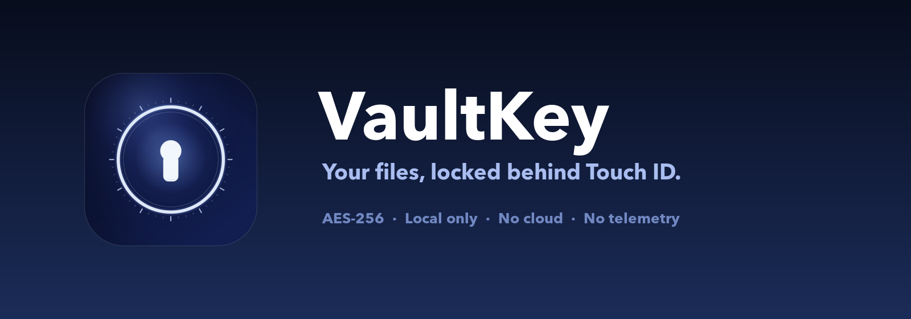

<p align="center">
  
</p>

<p align="center">
  <a href="#requirements"></a>
  <a href="#build"></a>
  <a href="#verification"></a>
  <a href="#local-only"></a>
</p>

<p align="center">
  A local-only encrypted vault for macOS. Your files stay on your Mac, behind Touch ID.
</p>

---

VaultKey is a native SwiftUI app that keeps files and folders inside an AES-256
encrypted APFS sparse-bundle disk image and asks for Touch ID before opening it.
There is no cloud, no account, no sync, no analytics, and no telemetry.

It is designed for one Mac and one user: a quiet place for documents you do not
want sitting in plain sight in Finder.

> [!IMPORTANT]
> Touch ID is enforced by VaultKey, not by a Secure Enclave–backed Keychain ACL.
> The app-level gate is honest about its limits. Read the
> [security model](#security-model) before trusting VaultKey with data that
> matters. VaultKey is not a replacement for FileVault.

## Contents

- [Features](#features)
- [Requirements](#requirements)
- [Quick start](#quick-start)
- [Build options](#build-options)
- [Using VaultKey](#using-vaultkey)
- [Recovery key](#recovery-key)
- [Security model](#security-model)
- [Limitations](#limitations)
- [Project layout](#project-layout)
- [Verification](#verification)
- [Status](#status)

## Features

| | |
| --- | --- |
| **AES-256 at rest** | An Apple encrypted APFS sparse bundle. When locked, the vault is ciphertext on disk. |
| **Touch ID unlock** | A fresh `LAContext` check for every unlock, with authentication reuse disabled. Optional Mac password fallback. |
| **Finder-clean** | Mounted at a private path, never under `/Volumes`. No Desktop icon, no Finder sidebar entry. |
| **Verified import** | Files are copied into the vault, checked, and only then removed from their original location. |
| **Restore or delete** | Restore items to a folder you choose, or delete them permanently. |
| **Locks itself** | Auto-lock after inactivity, plus screen lock, sleep, main-window close, and quit. |
| **Recovery key** | A 160-bit Crockford base32 key that also opens the disk image in Disk Utility. |
| **Local only** | No networking code, no account, no cloud, no crash reporting, no telemetry. |

## Requirements

- macOS 14 or later. Built and tested on macOS 26.
- Apple Silicon or Intel Mac.
- Touch ID recommended. Mac password fallback is optional.
- Command Line Tools for building. Xcode is not required.
- An Apple Development signing identity is optional. The build falls back to
  ad-hoc signing.

## Quick start

```sh
git clone https://github.com/angh-ching/VaultKey.git
cd VaultKey
./build.sh --test
mkdir -p ~/Applications
ditto .build/VaultKey.app ~/Applications/VaultKey.app
open ~/Applications/VaultKey.app
```

The app is assembled at `.build/VaultKey.app`. No prebuilt binary is committed;
VaultKey is built locally from source.

On first launch, choose a name, maximum size, auto-lock delay, and whether to
allow the Mac password as a fallback. VaultKey asks for Touch ID, creates the
vault, and shows the recovery key once. Save that key before continuing.

The app is signed locally but not notarized. If Gatekeeper blocks a copied build,
right-click the app and choose **Open**.

## Build options

```sh
./build.sh                          # release build
CONFIG=debug ./build.sh             # debug build
./build.sh --test                   # build and run the core self-test
CODESIGN_IDENTITY=- ./build.sh      # ad-hoc signing
CODESIGN_IDENTITY="Apple Development: Your Name (TEAMID)" ./build.sh
```

By default, `build.sh` uses the first local Apple Development identity it finds.
If none is available, it signs ad hoc.

There is no `Package.swift`. This Command Line Tools installation cannot link
SwiftPM manifests, so `build.sh` compiles the app directly with `swiftc`.

## Using VaultKey

1. **Create a vault.** Pick a name and a maximum size. The size is a quota, not
   preallocated disk space.
2. **Add files or folders.** Drag them onto the window, or use **Add Files…**
   (`⌘O`) / **Add Folder…** (`⇧⌘O`). VaultKey copies each item, verifies the
   copy, then deletes the original. Originals do not go to the Trash.
3. **Lock the vault.** Use the toolbar button, **Vault → Lock Vault** (`⌘L`),
   close the main window, lock the screen, or let auto-lock fire. Closing the
   last window also quits the app.
4. **Restore.** Select an item, choose **Restore**, and pick a destination
   folder. VaultKey copies it out and verifies the copy.
5. **Delete.** Select an item and choose **Delete**. Deletion is permanent and
   does not use the Trash.

While unlocked, the vault appears as a normal mounted volume. **Vault → Open
Vault in Finder** (`⇧⌘V`) opens it at the private mount path.

## Recovery key

The recovery key is 32 characters of Crockford base32, shown in eight groups of
four. It is the actual passphrase of the encrypted disk image, so it works even
if VaultKey is deleted.

- **In VaultKey:** choose **Use Recovery Key…** on the lock screen and type the
  key with or without dashes. Lookalikes (`O`/`0`, `I`/`L`/`1`) are corrected.
- **In Disk Utility:** open
  `~/Library/Application Support/VaultKey/Vault.sparsebundle` and enter the
  **32 characters without dashes**.

The key is displayed only after a fresh Touch ID check. Treat it like a
password: write it down or put it in a password manager, and do not store it on
the same Mac.

If Touch ID, the Mac password fallback (if enabled), and the recovery key are
all lost, the files cannot be recovered.

## Security model

### Encryption at rest

The vault is an Apple sparse-bundle disk image using AES-256 and APFS. The
160-bit vault key is generated on this Mac with `SecRandomCopyBytes`. It is
encoded with Crockford base32 for the recovery key and used directly as the disk
image passphrase. Apple's `hdiutil` performs the encryption and mounting.

### Touch ID gate

VaultKey asks `LocalAuthentication` for a fresh biometric check before it reads
the key from Keychain. A new `LAContext` is created for every unlock, with
authentication reuse disabled. Strict mode removes the Mac password fallback.

The key is stored in the legacy login Keychain with an ACL that trusts the
VaultKey app. The data-protection Keychain and Secure Enclave access-control
attributes require an Apple-issued provisioning entitlement that a locally
signed app does not have; without it, macOS returns `-34018`
(`errSecMissingEntitlement`). As a result, **Touch ID is enforced by the app,
not by a hardware-bound Keychain ACL**. The Keychain item is still protected by
the login Keychain and its access prompt, but the biometric check itself is
performed in VaultKey before the read.

This is an honest limitation of building and signing the app locally without a
paid provisioning profile. Do not treat it as equivalent to a Secure Enclave
key.

### Locking

Auto-lock is wall-clock time since the last interaction with VaultKey, not
system-wide HID idle time. It is intentionally not reset by activity in other
apps. VaultKey also locks on screen lock, sleep, main-window close, and quit.
Closing the last window quits the app. Locking closes the encrypted volume with
`hdiutil detach`.

### Local only

There is no networking code, no account, no cloud sync, no crash reporting, and
no telemetry. The app does not request network entitlements. All state stays in
the paths below.

| Item | Path |
| --- | --- |
| Encrypted vault | `~/Library/Application Support/VaultKey/Vault.sparsebundle` |
| Configuration | `~/Library/Application Support/VaultKey/config.json` |
| Local activity log | `~/Library/Application Support/VaultKey/activity.jsonl` |
| Private mount point | `~/Library/Application Support/VaultKey/Mount` |
| Vault key | Login Keychain, service `com.local.vaultkey.vault` |

The support directory is owner-only (`0700`); the configuration and activity
log are owner-only (`0600`). The activity log never records file names.

### Threat model at a glance

| Scenario | What happens |
| --- | --- |
| Vault locked, disk image copied | The copy is AES-256 ciphertext. |
| Vault locked, attacker has your Mac account | The app gate and Keychain ACL are the barrier, not hardware. A malicious process with your session is the main risk. |
| Vault unlocked | Any process running as your user can read the mounted volume. Lock it when you step away. |
| Recovery key leaked | Full access, including through Disk Utility. Keep it offline. |
| Mac compromised | No local app can make an unlocked computer safe. |

## Limitations

- **While unlocked, the vault is a normal mounted volume.** Any app running as
  your user can read it.
- **Open files can block locking.** macOS may refuse to detach the volume while
  an app still has a file open. VaultKey reports the problem and offers a force
  lock instead of silently losing data.
- **Force quit or a crash can leave the volume mounted.** VaultKey closes a stale
  mount the next time it opens. Until then, the volume remains readable at the
  private mount path.
- **Deleted originals are removed, not securely overwritten.** FileVault protects
  freed blocks on disk; keep FileVault on. The same applies to files deleted
  inside the vault.
- **Copy verification is size and file-count based**, not a cryptographic hash of
  every byte. `FileManager.copyItem` does the copy; VaultKey verifies the result
  before removing the original.
- **A compromised Mac or a malicious process with your user session** can attack
  the app, the Keychain prompt, or the mounted volume.
- **The sparse bundle's maximum size is a quota, not preallocated space.** It
  grows as you add files, up to the configured limit.
- **No notarization.** The app is signed for local use, not distributed through
  Gatekeeper's notarization flow.

Keep macOS and FileVault enabled, use a strong Mac password, and lock your Mac
when you leave it.

## Project layout

```text
Sources/VaultKeyCore/     Encryption, disk image, Keychain, Touch ID, config,
                          activity log, security checks
Sources/VaultKey/         SwiftUI app, views, app model
Tests/main.swift          Core self-test (238 checks)
Tools/make_icon.swift     App icon generator
Resources/                Info.plist, icon, README banner
build.sh                  swiftc build, app assembly, code signing
```

### Design notes

- The vault is mounted with `hdiutil attach -nobrowse -noautoopen -mountpoint`
  at a hidden path. This avoids `/Volumes`, Desktop icons, and the Finder sidebar.
- The disk image is an APFS sparse bundle so it can grow on demand and be opened
  by Disk Utility without VaultKey.
- The vault contains `.vaultkey.json` (identity marker),
  `.metadata_never_index` (keeps Spotlight out), and macOS may create
  `.fseventsd`; VaultKey hides these system entries from the file list.
- Files are copied into a temporary folder inside the vault, checked, moved into
  place, and only then is the original removed. Duplicate names become
  `name 2.ext`.
- The app is one Swift module built with `-parse-as-library`; no SwiftPM.

## Verification

```sh
# Core behavior: create, add, detach, unlock, wrong key, identity mismatch,
# restore, delete, duplicates, reserved names, unsafe locations, locked access.
./build.sh --test

# Confirm the built app's signature and identifier.
codesign --verify --strict .build/VaultKey.app
codesign -dv .build/VaultKey.app

# Confirm there are no network entitlements.
codesign -d --entitlements :- .build/VaultKey.app
```

The self-test creates temporary vaults and removes them. It does not touch your
real vault.

## Status

Version 1.0. Built for local use on one Mac. Not independently audited. Back up
anything important before trusting any encryption tool with it. Use at your own
risk.
